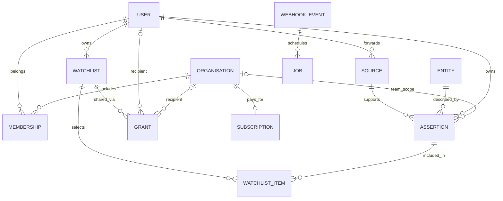
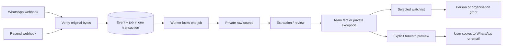

# DealWaggle architecture

## Product boundary

The first loop is **capture → review → team knowledge → deliberate sharing**. An original message is evidence. It is not a company record, and its entire body must not become visible just because one sentence is shared.

The three application components are a PostgreSQL database, a FastAPI backend (API and workers are separate processes), and a React frontend. The same Python model package is used by the API, workers and migrations. The supplied design system is a shared npm workspace.

## Knowledge is not the entity

An entity has a stable ID, a name and a kind: person, company, fund or transaction. Kind-specific tables provide identity and relational anchors. Transactions reference a company; the amount, round, participants, date and terms belong to assertions because they may be non-public or disputed.

An **assertion** is one sourced piece of knowledge about an entity:

- Content: field, value and signal (`confirmed`, `reported`, `hearsay`). The first slice uses text values; structured typed values and relationship assertions can be added without changing the access model.
- Ownership: the contributor's user ID. Ownership does not transfer when something is shared.
- Initial visibility: an organisation ID for team visibility; null for a private exception.
- Public classification: an explicit `is_public` flag reserved for trusted public-data import. Normal capture requests cannot set it.
- Provenance: raw source ID, safe attribution, channel and observation timestamp.
- Internal flag: a note that must never enter the forward/export workflow.

Different assertions can disagree. New evidence is appended; facts are not silently overwritten. Names are stored on the entity, so the API reveals entity IDs and labels only when the requester can see at least one assertion. Counts and summaries are calculated from visible assertions. There is no unauthorised global entity search or existence endpoint.

The first slice creates new identities on capture unless an accessible `entity_id` is explicitly supplied. It does not merge names automatically. Entity resolution needs review, domain identifiers and a merge audit before agents can combine records safely.

## Access rules

An authenticated user can read an assertion if **any** of these is true:

1. It is explicitly public.
2. They own it.
3. They are a current member of its team organisation.
4. A live watchlist grant gives them access directly or through current organisation membership.

Watchlist grants are read access, not permission to re-share. Only the contributor can add a private fact to a watchlist or prepare an external draft from it. Public facts can be forwarded by any authenticated reader. Internal notes may be team-visible, but never enter watchlists or forwards.

A selected watchlist shares **assertion IDs**, not entities. Sharing a company-wide pointer would accidentally reveal future notes and is deliberately avoided. An all-knowledge watchlist is explicitly different: it includes the owner's present and future non-internal assertions, including private exceptions. Creating the list alone grants no access; recipients must be added separately.

Changing a fact to private removes its selected-watchlist memberships. If the owner has an active all-knowledge grant, the API refuses the change until those grants are revoked. This avoids claiming that a fact is private while a dynamic grant still exposes it.

Removing a grant, removing an item or removing organisation membership affects the next API read. Existing public access, independent grants or team membership may still confer access. Revocation cannot erase information already seen or copied to WhatsApp/email. A copied forward is a separate disclosure, not a revocable app session.

Raw source bodies stay in the forwarding owner's inbox in this first slice. Reviewed assertions use team-default visibility. Sharing an assertion exposes its approved attribution and signal but never the original message, unrelated assertions or source IDs. Source attribution itself can be sensitive; the review form explicitly shows the attribution that will be shared.

Authorisation is enforced in the backend's shared query predicate, not just the frontend. Direct database access is privileged. **PostgreSQL row-level security is not yet implemented**; do not expose SQL, a database connector or an agent with unrestricted queries to customers. Add RLS/least-privilege worker roles before introducing independent services that bypass these API paths.

## Workflows and durability

The API verifies signatures before accepting events, then saves both the event and job in one transaction. Replayed provider event IDs are idempotent. WhatsApp payload hashes deduplicate deliveries, and individual WhatsApp message IDs deduplicate messages across different batches. Batches fan out into separate jobs so an unlinked sender cannot block an unrelated valid message.

PostgreSQL workers select one available job using `FOR UPDATE SKIP LOCKED`. Work and its resulting database writes commit together; a crash rolls back and releases the lock. Provider reads happen inside that bounded transaction in this initial design. Transient errors retry with exponential backoff up to five attempts; failures retain only the exception class, not message bodies or credentials. Missing providers, unknown identities and unsupported formats become blocked jobs for explicit operator review.

SQLite workers must remain single-process. Larger or long-running agents will need leased jobs, heartbeats, fencing and an outbox for external writes. Do not add unbounded model calls while holding database locks. Any future outbound send must have a durable idempotency key and an explicit disclosure decision.

## Agents

`ExtractionProvider` and `EnrichmentProvider` define bounded proposal outputs. The default provider is deliberately unconfigured; it creates no invented facts. Extraction jobs mark the source as needing human review. LinkedIn enrichment requests are queued only for paid organisations and valid HTTPS LinkedIn profile URLs, then block pending an implementation.

Future extraction must treat message text as untrusted data, keep the raw evidence, validate structured output, preserve uncertainty and inherit the source disclosure scope. It must not accept access-control instructions from messages, execute links or SQL, publish facts, select recipients or send messages. Proposals need provenance and evidence spans, not just generated summaries. Model-derived confidence is not the same as the product's source signal.

Enrichment needs a chosen data provider and an explicit access policy. This repository does not scrape LinkedIn, bypass authentication or send source messages to an LLM. Public web evidence can contribute independently sourced public facts; private inputs and derived summaries must not become public through enrichment.

## Identity, billing and future messaging

Production API requests use RS256 bearer tokens validated against an issuer, audience and HTTPS JWKS endpoint. Accounts and memberships are provisioned separately. `X-Demo-User` is ignored unless demo mode is explicitly enabled; production configuration rejects demo mode. The frontend has an in-memory access-token integration point; the browser sign-in flow, invitations and account lifecycle remain to be implemented.

Organisations are billing accounts. Only owners can create checkout/portal sessions. Stripe events trigger a fresh read of current subscription state while holding the organisation lock, so stale event snapshots cannot reinstate cancelled access. Only the configured price with an active/trialing subscription grants the first premium entitlement. A browser success URL never grants access.

Watchlists provide in-app knowledge sharing now. Chat threads, recipient inboxes, notification preferences, recommendation profiles and actual outbound WhatsApp/email sends are separate future features. Recommendations must operate only on data visible to the requesting user and should propose recipients, never disclose information automatically.

## Access is not proof of knowledge

Grants answer “who can read this now.” Audit records capture changes and draft preparation. They do not prove that a recipient read or understood a fact. If the product needs “who actually knows,” add separate delivery/read events and explicit acknowledgements rather than inferring that from permission alone. Cross-channel forwarded messages cannot provide a complete knowledge graph of their eventual recipients.
